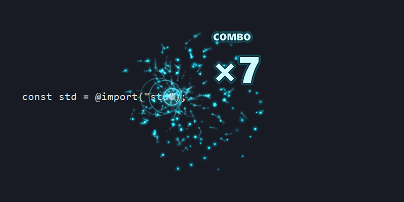
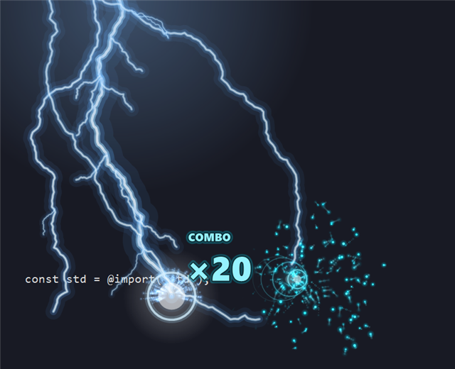
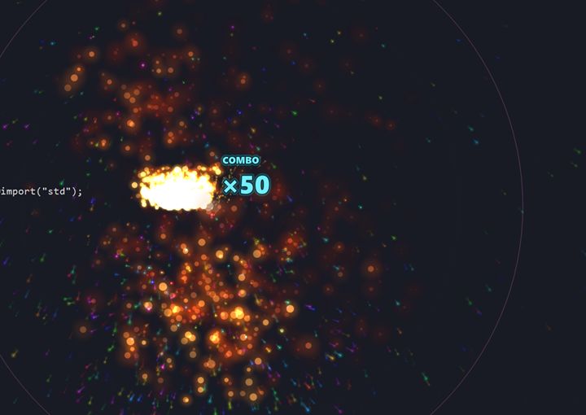
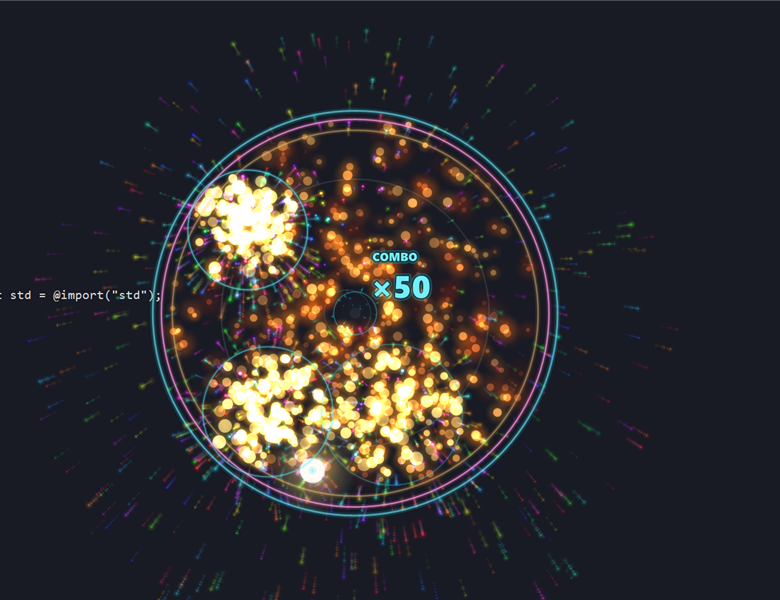

# Coding Effect

Windows 上のどのアプリでも、文字を入力するとキャレット（入力位置）からエフェクトが出る常駐ツール。

*A Windows tray app that adds particle, lightning, fire and explosion effects at the text caret whenever you type — in any app. (English summary at the bottom.)*

| 文字入力：粒子が集まる | Enter：落雷 |
|---|---|
|  |  |
| **Backspace / Delete：炎** | **50 文字コンボ：大爆発** |
|  |  |

## 機能

- 文字キー：シアン（テーマ色）の粒子がキャレットへ集まり、光って弾ける
- Backspace / Delete：閃光とともに左上へ吹き出す炎
- Enter：画面上端の外から本雷＋副雷が落ち、空が光り、着弾点で二重リング
- 連打でコンボ数表示（50 文字ごとに四重リングの大爆発＋周囲で小爆発が連鎖）
- テーマ 5 色（シアン / レインボー / ファイア / サクラ / マトリックス）
- 派手さ 5 段階（控えめ / 標準 / 派手 / 爆発 / 限界突破）
- 文字サイズ（キャレットの高さ）に合わせてエフェクトの大きさが変わる
- Ctrl / Alt / Win を押しながらのショートカット操作では出ない

## 動作環境

- Windows 10 / 11（x64）
- [.NET 9 Desktop Runtime](https://dotnet.microsoft.com/download/dotnet/9.0)（Release の exe を使う場合）／ .NET 9 SDK（ソースからビルドする場合）

## 使い方

### Release から

1. [Releases](../../releases) から `CodingEffect-<version>-win-x64.zip` をダウンロードして展開する
2. `CodingEffect.exe` を実行する

### ソースから

```
dotnet build -c Release
bin\Release\net9.0-windows\CodingEffect.exe
```

起動するとタスクトレイにアイコンが出る。右クリックでテーマ・派手さ・各種 ON/OFF・終了。ダブルクリックで ON/OFF 切り替え。

## プライバシー

- キーボードフックで受け取るのは「どの種類のキーが押されたか（文字 / Space / Enter / 削除）」だけで、**入力内容は記録・保存・送信しない**。
- ネットワーク通信は一切しない。
- 保存するのは設定ファイル `%APPDATA%\CodingEffect\settings.json` だけ。

## 注意

- オンラインゲームではアンチチート（不正対策ソフト）が、キーボードフックや最前面のオーバーレイを検知する可能性がある。ゲーム中は終了するか、設定の `ExcludedProcesses` に入れること。
- 本ソフトウェアは無保証で提供される（[LICENSE](LICENSE) 参照）。

## 設定ファイル

`%APPDATA%\CodingEffect\settings.json`（トレイメニュー「設定ファイルを開く」で開ける）

```json
{
  "Enabled": true,
  "Theme": "Cyan",            // Cyan / Rainbow / Fire / Sakura / Matrix
  "Intensity": 1.0,           // 派手さの倍率 0.2〜5
  "Combo": true,              // コンボ表示と 50 文字ごとの大爆発
  "ComboMin": 5,              // この連打数からコンボを表示
  "FireOnDelete": true,       // 削除キーで炎
  "MouseFallback": true,      // 位置が取れないアプリではマウス位置に出す
  "CaretDelayMs": 25,         // キー押下後、キャレット移動を待つ時間（ms）
  "ExcludedProcesses": []     // 出さないアプリのプロセス名（例: "obs64"）
}
```

編集後はトレイメニューの「設定を再読み込み」。

## 既知の制限

- 管理者権限で動いているアプリ上では、このツールも管理者で起動しないとキー検知できない。
- キャレット位置を公開していないアプリ（一部のゲーム、独自描画のエディタ等）ではマウス位置に出る。
- フルスクリーン（排他モード）のゲーム上には表示できない。

## 開発者向け

### 仕組み

| 部分 | ファイル | 内容 |
|---|---|---|
| キー検知 | `src/KeyboardHook.cs` | `WH_KEYBOARD_LL` フック。キーの種類だけ判定し、入力内容は保存しない |
| 位置取得 | `src/CaretLocator.cs` / `src/CaretWorker.cs` | ① Win32 システムキャレット（`GetGUIThreadInfo`）→ ② UI Automation の TextPattern → ③ 同じ窓の直前位置 → ④ マウス位置。別スレッドで実行 |
| 描画 | `src/OverlayWindow.cs` | クリック透過・最前面・非アクティブの layered window。エフェクトがある範囲だけを `UpdateLayeredWindow` |
| エフェクト | `src/EffectEngine.cs` | パーティクル物理・落雷・コンボ表示。火花・炎・集束の粒は加算合成でピクセルを直接書き、横帯ごとに並列描画 |
| 設定 | `src/Settings.cs` | 設定の読み書き |

### 強さの調整と計測

- 全体の強さは `src/EffectEngine.cs` の `PowerCount`（粒の数の倍率、既定 3）と `PowerSize`（大きさの倍率、既定 1.4）。トレイの「派手さ」はこれにさらに掛かる。
- キー入力なしで再生して描画時間と静止画を出す: `CodingEffect.exe --bench <出力フォルダ> [派手さ]`
- 使用中の描画時間を記録する: 環境変数 `CODINGEFFECT_PERF` にログファイルのパスを入れて起動

### アイコン

`assets/app.ico`（16〜256px）は `assets/make-icon.ps1` で生成している。

```
powershell -ExecutionPolicy Bypass -File assets\make-icon.ps1
```

### Release 用の exe を作る

```
dotnet publish -c Release -r win-x64 --self-contained false -p:PublishSingleFile=true -p:DebugType=none -o publish
```

## English summary

Coding Effect is a Windows tray app that shows effects at the text caret in any application:
cyan particles gather on each keystroke, lightning strikes from the top of the screen on Enter,
fire bursts on Backspace/Delete, and a big explosion fires every 50 typed characters.
It only looks at *which kind* of key was pressed — keystrokes are never logged, stored or sent anywhere,
and the app makes no network connections. Requires Windows 10/11 x64 and the .NET 9 Desktop Runtime.
Anti-cheat software in online games may flag keyboard hooks or overlays; quit the app or add the game to
`ExcludedProcesses` while playing. Licensed under the MIT License.

## License

[MIT](LICENSE)
